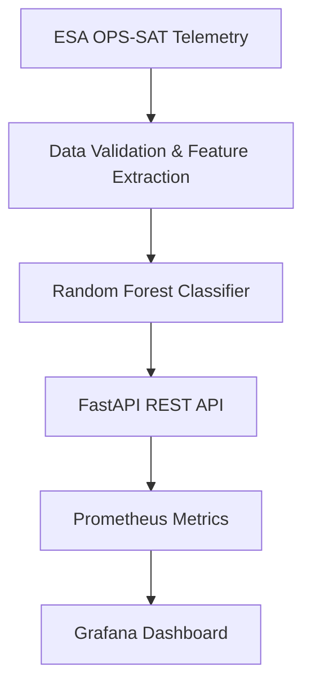

# SAT-GUARD
### Intelligent Spacecraft Telemetry Monitoring & Anomaly Detection

**Python • Machine Learning • FastAPI • Prometheus • Grafana • Docker**

SAT-GUARD is an end-to-end spacecraft telemetry anomaly detection and monitoring prototype built using real historical telemetry from the European Space Agency's OPS-SAT mission.

The system processes spacecraft magnetometer measurements, extracts statistical and temporal features, and uses a Random Forest classifier to identify anomalous telemetry segments.

A FastAPI backend serves predictions, while Prometheus and Grafana provide monitoring of anomaly detections, prediction throughput, and processing latency.

The project combines **communications engineering, data science, software engineering, and observability** in a space-systems application.

## 1. System Architecture



**Technology stack:** Python, Pandas, NumPy, SciPy, scikit-learn, FastAPI, Pydantic, pytest, Prometheus, Grafana, Docker Compose.

The application processes completed telemetry segments rather than individual measurements in real time.

## 2. Dataset & Machine Learning

SAT-GUARD uses the publicly available [ESA OPS-SAT dataset](https://zenodo.org/records/15108715).

| Dataset Property | Value |
|---|---:|
| Telemetry measurements | 303,493 |
| Segments | 2,123 |
| Telemetry channels | 9 |
| Initial model channel | CADC0872 (Magnetometer) |
| Training segments | 414 |
| Testing segments | 132 |

The Random Forest uses **14 statistical and temporal features**, including mean, standard deviation, skewness, kurtosis, measurement differences, and peak-change characteristics.

**Model configuration:** 200 trees, maximum depth 8, balanced class weights, random state 42.

### Evaluation Results

The enhanced Random Forest achieved the following results on the official held-out partition for CADC0872:

| Metric | Result |
|---|---:|
| **Precision** | **93.75%** |
| **Recall** | **93.75%** |
| **F1-score** | **0.9375** |
| Accuracy | 96.97% |
| False-positive rate | 2.00% |

**Confusion matrix:** TP = 30, TN = 98, FP = 2, FN = 2.

These results apply to the selected telemetry channel and test partition. Earlier model-development experiments informed feature selection, so this was not a completely untouched external benchmark.

## 3. API & Monitoring

SAT-GUARD provides the following FastAPI endpoints:

| Endpoint | Function |
|---|---|
| `GET /health` | Application health |
| `GET /api/v1/model/info` | Model metadata |
| `POST /api/v1/predict` | Telemetry anomaly classification |
| `GET /metrics` | Prometheus metrics |

Historical telemetry can be replayed through the API using the included Python scripts.

Prometheus collects prediction counts, anomaly counts, and processing duration. Grafana visualizes these metrics through an operations dashboard.

### Grafana Monitoring Dashboard


## 4. Installation & Reproduction

**Prerequisites:** Python, Docker, Docker Compose, and the ESA OPS-SAT dataset.

Clone the repository:

```bash
git clone https://github.com/samuelHenris/sat-guard.git
cd sat-guard

python3 -m venv .venv
source .venv/bin/activate
pip install -e ".[dev]"
```

Download the [ESA OPS-SAT dataset](https://zenodo.org/records/15108715) and place `segments.csv` inside `data/raw/`.

Generate the features and trained model:

```bash
python run_features.py
python save_model.py
```

Start the application:

```bash
docker volume create sat-guard-prometheus-data
docker volume create sat-guard-grafana-data
docker compose up -d --build
```

Access the services:

| Service | URL |
|---|---|
| FastAPI | http://localhost:8000/docs |
| Prometheus | http://localhost:9090 |
| Grafana | http://localhost:3000 |

Replay historical telemetry:

```bash
python scripts/replay_telemetry.py --limit 5 --delay 1
```

The raw dataset and trained model artifacts are excluded from version control and can be regenerated locally.

## 5. Testing

SAT-GUARD uses pytest for automated testing of data validation, feature extraction, model persistence, API endpoints, and telemetry replay.

```bash
python -m pytest -q
```

**Latest verification: 21 tests passed.**

## 6. Limitations & Future Work

SAT-GUARD is a ground-based engineering prototype, not a flight-qualified spacecraft monitoring system.

Current limitations include:

- Anomaly classification is performed on completed telemetry segments.
- The trained model currently supports only channel CADC0872.
- Model probabilities are not calibrated spacecraft fault probabilities.
- Generalization to other spacecraft and operational environments has not been established.

Future work includes multi-channel anomaly detection, incremental inference, broader validation, and Kubernetes deployment.

## 7. Author

**Samuel Henry-Abiola**  
MSc (Technology), Communications Engineering and Data Science  
Aalto University / Instituto Superior Técnico

BSc Software Engineering — West Ukrainian National University

[GitHub](https://github.com/samuelHenris) | [LinkedIn](https://www.linkedin.com/in/samuelhenria/)

*Independent engineering portfolio project using publicly available ESA spacecraft telemetry.*