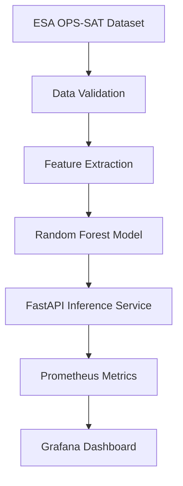

# SAT-GUARD

### Intelligent Spacecraft Telemetry Monitoring and Anomaly Detection Platform

**Python | Machine Learning | FastAPI | Prometheus | Grafana | Docker**

SAT-GUARD is an end-to-end spacecraft telemetry anomaly detection and monitoring platform developed using real historical satellite telemetry from the European Space Agency's (ESA) OPS-SAT mission.

The project integrates signal processing, statistical feature engineering, machine learning, REST API development, and system observability to identify anomalous spacecraft sensor behavior and monitor detection-system performance.

SAT-GUARD uses a Random Forest classifier trained on statistical and temporal features extracted from spacecraft magnetometer measurements. The trained model is integrated into a FastAPI backend that processes completed telemetry segments and returns anomaly predictions.

Prometheus collects application metrics, while Grafana provides dashboards for monitoring predictions, anomaly detections, processing throughput, and inference latency.

The application is containerized using Docker and deployed locally through Docker Compose.

> **Project scope:** SAT-GUARD is a ground-based engineering and research prototype using historical spacecraft telemetry. It does not communicate with operational satellites or provide flight-qualified anomaly detection.

---

## 1. Problem Statement

Spacecraft rely on telemetry measurements to monitor onboard systems, sensor behavior, and operational conditions.

However, spacecraft telemetry can contain abnormal patterns, measurement noise, missing observations, and unexpected variations.

Identifying these anomalies can be challenging, particularly when differences between normal and abnormal operating conditions are subtle.

Traditional threshold-based monitoring approaches may struggle to distinguish genuine anomalies from normal signal variations, potentially generating false alarms or missing unusual behavior.

Machine learning provides an alternative approach by learning relationships between multiple statistical and temporal characteristics of sensor measurements.

SAT-GUARD investigates how lightweight machine learning models can support spacecraft telemetry anomaly detection while remaining integrated with backend services and monitoring infrastructure.

---

## 2. Project Objectives

The primary objective of SAT-GUARD is to develop and evaluate an end-to-end spacecraft telemetry anomaly detection and monitoring prototype.

The project aims to:

1. Process and validate real historical spacecraft telemetry from ESA OPS-SAT.
2. Extract statistical and temporal features from spacecraft sensor measurements.
3. Train and evaluate machine learning models for segment-level anomaly classification.
4. Expose anomaly predictions through a REST API developed with FastAPI.
5. Implement historical telemetry replay to demonstrate automated inference.
6. Monitor predictions, anomaly detections, and application performance using Prometheus and Grafana.
7. Package the application using Docker Compose.
8. Validate the implementation using automated software tests.

---

## 3. System Architecture

SAT-GUARD follows a modular architecture that separates telemetry processing, machine learning, API development, and observability.



### Architecture Components

| Component | Technology | Responsibility |
|---|---|---|
| Telemetry ingestion | Python, Pandas | Load spacecraft telemetry |
| Data validation | Pandas, NumPy | Validate measurements, timestamps, and labels |
| Feature extraction | NumPy, SciPy | Calculate statistical and temporal features |
| Anomaly detection | scikit-learn | Classify telemetry segments |
| Model persistence | Joblib | Save and load the trained classifier |
| Backend API | FastAPI, Pydantic | Serve predictions and model information |
| Telemetry replay | Python, HTTPX | Replay historical telemetry segments |
| Metrics collection | Prometheus | Collect application performance metrics |
| Visualization | Grafana | Display monitoring dashboards |
| Containerization | Docker | Package the application |
| Orchestration | Docker Compose | Run the local application stack |
| Testing | pytest | Validate application functionality |

### Data Processing Flow

1. Historical telemetry measurements are loaded from the ESA OPS-SAT dataset.
2. The data is validated for missing values, timestamp consistency, and segment integrity.
3. Measurements are grouped into telemetry segments.
4. Statistical and temporal features are extracted from each completed segment.
5. The trained Random Forest classifies the segment as normal or anomalous.
6. FastAPI returns the classification and anomaly score.
7. Prometheus collects prediction and processing metrics.
8. Grafana visualizes the application's operational behavior.

---

## 4. Dataset

### ESA OPS-SAT Telemetry

The project uses publicly available historical telemetry from ESA's OPS-SAT mission.

Dataset characteristics:

| Property | Value |
|---|---|
| Total measurements | 303,493 |
| Telemetry segments | 2,123 |
| Telemetry channels | 9 |
| Normal segments | 1,689 |
| Anomalous segments | 434 |
| Data type | Time-series spacecraft sensor measurements |

Each telemetry record contains:

- `channel` — telemetry channel identifier
- `timestamp` — measurement timestamp
- `value` — sensor measurement
- `label` — dataset annotation metadata
- `sampling` — nominal sampling interval
- `anomaly` — binary anomaly label
- `segment` — telemetry segment identifier
- `train` — official training/testing partition indicator

### Initial Telemetry Channel

The initial anomaly detection model focuses on:

**CADC0872 — Magnetometer telemetry**

This channel contains:

- 546 telemetry segments
- 414 training segments
- 132 testing segments
- 131 labeled anomalous segments

The original dataset's training and testing partitions are preserved.

### Segment-Level Classification

A telemetry segment contains multiple consecutive measurements from the same sensor channel.

SAT-GUARD extracts features from the completed segment and predicts whether that segment is normal or anomalous.

Therefore:

**One completed segment represents one classification example.**

The current implementation does not perform instantaneous anomaly detection on individual incoming measurements.

---

## 5. Feature Engineering

SAT-GUARD extracts 14 numerical features from completed telemetry segments.

These features describe the distribution and temporal behavior of the sensor measurements.

### Statistical Features

| Feature | Description |
|---|---|
| Mean | Average sensor measurement |
| Standard deviation | Measurement variability |
| Minimum | Lowest recorded value |
| Maximum | Highest recorded value |
| Median | Central measurement value |
| Interquartile range | Spread between the 25th and 75th percentiles |
| Skewness | Asymmetry of the measurement distribution |
| Kurtosis | Characteristics of the distribution's tails |

### Temporal and Segment Features

| Feature | Description |
|---|---|
| Mean absolute difference | Average magnitude of consecutive measurement changes |
| Maximum absolute difference | Largest change between consecutive measurements |
| 95th-percentile absolute difference | Upper percentile of measurement changes |
| Difference standard deviation | Variability of consecutive measurement differences |
| Gap count | Number of detected sampling discontinuities |
| Segment length | Number of measurements in the segment |

Timestamp discontinuities are considered during temporal feature extraction.

Measurement differences across detected gaps are excluded from the consecutive-difference calculations.

The extracted features provide a fixed-length representation of variable-length telemetry segments.

---

## 6. Machine Learning Model

SAT-GUARD uses a Random Forest classifier implemented with scikit-learn.

### Model Configuration

| Parameter | Value |
|---|---|
| Algorithm | Random Forest |
| Number of estimators | 200 |
| Maximum depth | 8 |
| Minimum samples per leaf | 3 |
| Class weighting | Balanced |
| Random state | 42 |
| Input features | 14 |
| Model version | 0.1.0 |

The model is trained using the official training partition of the ESA OPS-SAT dataset.

The trained classifier is serialized using Joblib and loaded by the FastAPI application during startup.

The saved model artifact includes:

- Trained Random Forest classifier
- Expected feature names and ordering
- Supported telemetry channel
- Model version

This allows the API to perform inference without retraining the model for each request.

---

## 7. Model Evaluation

The enhanced Random Forest was evaluated on the official held-out test partition for telemetry channel CADC0872.

### Evaluation Dataset

| Partition | Normal | Anomalous | Total |
|---|---:|---:|---:|
| Training | 315 | 99 | 414 |
| Testing | 100 | 32 | 132 |

### Evaluation Results

| Metric | Result |
|---|---:|
| Precision | **93.75%** |
| Recall | **93.75%** |
| F1-score | **0.9375** |
| Accuracy | **96.97%** |
| False-positive rate | **2.00%** |

### Confusion Matrix

| Actual / Predicted | Normal | Anomalous |
|---|---:|---:|
| Normal | 98 | 2 |
| Anomalous | 2 | 30 |

The classifier correctly identified 30 of the 32 anomalous test segments while incorrectly classifying two normal segments as anomalous.

These results demonstrate promising performance for the selected OPS-SAT telemetry channel.

The official test partition was excluded from model fitting. However, earlier experiments informed subsequent feature development, so the final held-out evaluation should not be interpreted as a completely untouched external benchmark.

The results do not establish generalization to other telemetry channels, spacecraft, or operational environments.

---

## 8. REST API

SAT-GUARD exposes its anomaly detection functionality through a REST API developed using FastAPI.

### Available Endpoints

| Endpoint | Method | Description |
|---|---|---|
| `/health` | GET | Application health and model availability |
| `/api/v1/model/info` | GET | Model metadata and expected features |
| `/api/v1/predict` | POST | Classify a completed telemetry segment |
| `/metrics` | GET | Prometheus-compatible application metrics |

### Prediction Response

Example response:

```json
{
  "channel": "CADC0872",
  "model_version": "0.1.0",
  "prediction": 1,
  "classification": "anomalous",
  "anomaly_probability": 0.998,
  "measurement_count": 280
}
```

This example was produced using historical OPS-SAT telemetry segment 1.

The API validates incoming measurements using Pydantic.

Validation includes:

- Supported telemetry channel
- Valid timezone-aware timestamps
- Strictly increasing measurement timestamps
- Positive sampling intervals
- Finite numerical measurements
- Supported segment length

The returned anomaly score is derived from the Random Forest's predicted class probability. It is not calibrated as a real-world spacecraft fault probability.

---

## 9. Historical Telemetry Replay

SAT-GUARD includes a Python-based historical telemetry replay utility.

The replay engine retrieves completed telemetry segments, orders them chronologically, and submits them to the prediction API.

This allows repeated inference requests to be demonstrated without requiring access to operational spacecraft.

### Replay Features

- Chronological ordering of historical segments
- Configurable number of segments
- Configurable delay between requests
- Optional normal/anomalous label filtering
- HTTP response validation
- Request latency measurement
- Prediction and ground-truth comparison

### Example

```bash
python scripts/replay_telemetry.py --limit 5 --delay 1
```

Replay anomalous training segments:

```bash
python scripts/replay_telemetry.py --limit 5 --delay 1 --label 1
```

The replay utility uses historical training-partition examples for demonstrations.

Replay results are not considered independent model evaluation results.

---

## 10. Monitoring and Observability

SAT-GUARD integrates Prometheus and Grafana to monitor anomaly detection activity and application performance.

### Prometheus Metrics

The FastAPI application exposes metrics through:

```text
GET /metrics
```

Custom metrics include:

| Metric | Description |
|---|---|
| `sat_guard_predictions_total` | Total completed predictions |
| `sat_guard_anomalies_total` | Total anomalous classifications |
| `sat_guard_prediction_duration_seconds` | Feature extraction and prediction processing duration |

Prometheus collects these metrics periodically through its configured scrape target.

### Grafana Dashboard

The SAT-GUARD Operations Dashboard contains four monitoring panels:

1. Total Predictions
2. Anomalies Detected
3. Prediction Throughput
4. Average Prediction Processing Latency

The dashboard provides visibility into how the inference service behaves while processing historical telemetry.

Prediction metrics are distinguished from the spacecraft's original sensor measurements.

The dashboard is designed to monitor application behavior rather than diagnose the physical cause of spacecraft anomalies.

---

## 11. Project Structure

```text
sat-guard/
│
├── data/
│   ├── raw/
│   └── processed/
│
├── src/
│   └── sat_guard/
│       ├── api/
│       │   ├── main.py
│       │   ├── schemas.py
│       │   └── metrics.py
│       ├── data/
│       │   ├── loader.py
│       │   ├── validation.py
│       │   └── diagnostics.py
│       ├── features/
│       │   └── extraction.py
│       └── models/
│           ├── training.py
│           └── persistence.py
│
├── scripts/
│   ├── create_prediction_request.py
│   └── replay_telemetry.py
│
├── tests/
├── monitoring/
│   ├── prometheus/
│   └── grafana/
│
├── artifacts/
├── reports/
├── Dockerfile
├── compose.yaml
├── pyproject.toml
└── README.md
```

Raw datasets, generated reports, and model artifacts are excluded from version control.

---

## 12. Installation and Setup

### Prerequisites

- Python 3.14 or a compatible environment
- Docker Engine
- Docker Compose
- Git
- ESA OPS-SAT telemetry dataset
- A trained SAT-GUARD model artifact

### Clone the Repository

```bash
git clone https://github.com/samuelHenris/sat-guard.git
cd sat-guard
```

### Create a Python Virtual Environment

```bash
python3 -m venv .venv
source .venv/bin/activate
```

### Install Dependencies

```bash
python -m pip install -e ".[dev]"
```

### Prepare the Dataset

Download the ESA OPS-SAT telemetry dataset and place the original telemetry CSV at:

```text
data/raw/segments.csv
```

The application expects processed features at:

```text
data/processed/cadc0872_features.csv
```

Generate the processed features using the project's existing feature-extraction pipeline.

### Prepare the Model

The FastAPI service requires a trusted, locally generated model artifact at:

```text
artifacts/cadc0872_random_forest.joblib
```

The model is not included in the repository.

After generating the processed feature dataset, it can be trained using:

```python
import pandas as pd

from sat_guard.models.persistence import (
    train_final_model,
    save_model,
)

features = pd.read_csv(
    "data/processed/cadc0872_features.csv"
)

artifact = train_final_model(features)

save_model(
    artifact,
    "artifacts/cadc0872_random_forest.joblib",
)
```

The model should be trained using the official training partition only.

For reliable deserialization, use a compatible scikit-learn version. The evaluated model was trained using scikit-learn 1.9.1.

Only load trusted Joblib artifacts.

### Start the Application

The Docker Compose configuration uses persistent named Docker volumes.

Create the volumes if they do not already exist:

```bash
docker volume create sat-guard-prometheus-data
docker volume create sat-guard-grafana-data
```

Build and start the services:

```bash
docker compose up -d --build
```

Verify:

```bash
docker compose ps
```

### Access the Services

| Service | URL |
|---|---|
| FastAPI | http://127.0.0.1:8000 |
| API documentation | http://127.0.0.1:8000/docs |
| Prometheus | http://127.0.0.1:9090 |
| Grafana | http://127.0.0.1:3000 |

The services run locally and are not publicly exposed.

The Grafana dashboard export is available in:

```text
monitoring/grafana/dashboards/
```

Depending on the Grafana version and dashboard schema, manual import or adjustments to provisioning may be required.

---

## 13. Automated Testing

SAT-GUARD uses pytest to verify the behavior of its major components.

Tests cover:

- Dataset validation
- Telemetry segment summaries
- Timestamp-gap detection
- Statistical feature extraction
- Temporal feature extraction
- Model serialization consistency
- FastAPI health and metadata endpoints
- Successful predictions
- Invalid telemetry requests
- Unsupported channels
- Historical replay ordering and filtering
- HTTP error handling

Run the test suite:

```bash
python -m pytest -q
```

Latest verified test result:

```text
21 passed
```

---

## 14. Limitations

SAT-GUARD is an engineering prototype and has several limitations.

**Single-channel model:** The current Random Forest supports only magnetometer channel CADC0872.

**Segment-level inference:** Predictions require completed telemetry segments. The system is not an instantaneous sample-level anomaly detector.

**Limited evaluation scope:** The reported evaluation uses one official test partition containing 132 segments.

**Model calibration:** Random Forest class probabilities are not calibrated as real-world spacecraft failure probabilities.

**Historical replay:** The replay engine simulates the submission of previously recorded telemetry segments rather than receiving operational satellite data.

**Operational validation:** The system has not been validated for flight use, real spacecraft operations, or mission-critical decision-making.

---

## 15. Future Improvements

Potential extensions include:

- Expanding anomaly detection to additional OPS-SAT telemetry channels.
- Comparing additional machine learning approaches.
- Investigating incremental detection on partially observed segments.
- Performing broader temporal and cross-channel robustness evaluations.
- Improving model explainability and probability calibration.
- Automating Grafana dashboard provisioning.
- Adding container health checks and deployment integration tests.
- Exploring deployment to a local Kubernetes cluster.

---

## 16. Dataset Attribution

This project uses historical telemetry from the European Space Agency's OPS-SAT anomaly detection dataset.

The original dataset and its associated research remain the work of their respective authors.

Dataset source:

https://zenodo.org/records/15108715

Users should consult the original dataset documentation for licensing, attribution requirements, and details of the telemetry annotations.

---

## Author

**Samuel Henry-Abiola**

MSc (Technology), Communications Engineering and Data Science  
Aalto University / Instituto Superior Técnico

BSc Software Engineering  
West Ukrainian National University

GitHub: https://github.com/samuelHenris

LinkedIn: https://www.linkedin.com/in/samuelhenria/

---

*SAT-GUARD is an independent engineering portfolio project developed using publicly available spacecraft telemetry.*
